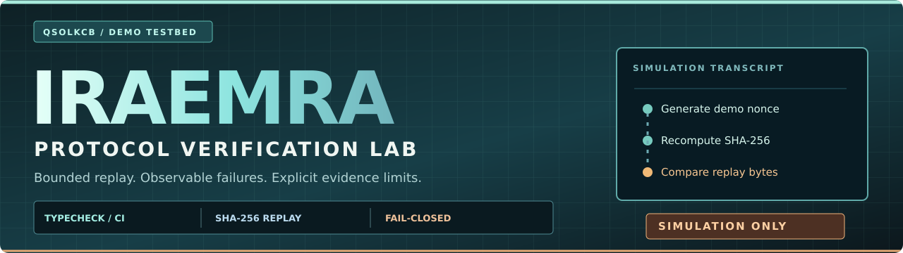

  
  
  

> [!CAUTION]
> **PROTOTYPE / SIMULATION ONLY.** This browser project does **not** implement, certify, or validate a real emergency-response system, school monitoring system, lawful video evidence capture, authorization service, immutable event log or chain of custody. No safety decision should be based on its output.

## QSOLKCB contribution — strict checks and replayable demonstration

This is a fork of [the original IRAEMRA repository](https://github.com/ApexSignalAndrewRusher/IraemraAI-School-Saftey-Video-Protocol). The repair branch provides a narrowly scoped, testable software **demonstration**, not a ready-to-deploy safety product.

- **TypeScript and Web Crypto correctness:** strict compiler checking; standard asynchronous SHA-256 hashing; clear handling of failure and unimplemented authorization.
- **VANILLAJS-style boundaries:** a small dependency-free pure replay module, separating byte-level operations from browser controls.
- **OPT-style invariants:** the same 32-byte nonce is replayed and compared against its original digest. This demonstrates repeatability, **not** authentic incident evidence or chain of custody.
- **CI:** TypeScript check, deterministic unit tests and production Vite build on GitHub Actions. No deployment is performed by the verification workflow.

The patch is documented in [the correctness and safety-scope report](docs/CORRECTNESS.md). The upstream README and its licensing text are preserved below, without revision.

## Licensing clarification required

The original text below refers to MIT but contains placeholders rather than the full standard licence, as well as an additional determinism clause. **The original author's intended licensing and restrictions need clarification.** This contribution does not replace those terms or independently assert redistribution rights.

## Upstream author's README (preserved verbatim)

MIT License

Copyright (c) 2025 Andrew Rusher

Permission is hereby granted, free of charge, to any person obtaining a copy...

[Standard MIT text]

Additional VCH Determinism Clause:
Any derivative work must preserve:
- 100% fixed-point arithmetic (no floating point)
- Cryptographic immutability of override logs
- Symmetric judgment under VCH formula
- Open source transparency
